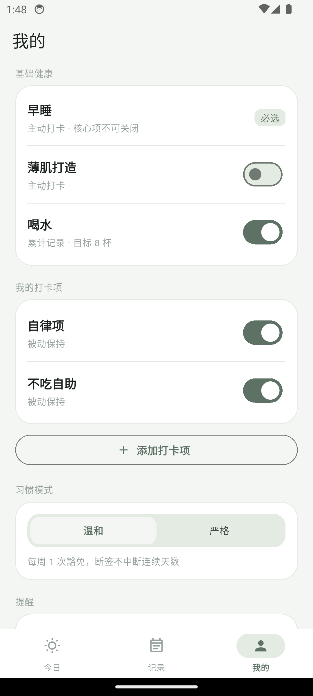

# LiveBetter

一个专注「长期坚持」的本地打卡 App：四种打卡类型、稳定的统计口径、零账号零云同步，所有数据只留在你自己的手机里。

> Android 7.0+ ｜ Flutter 单代码库 ｜ Apache-2.0 ｜ 全功能离线可用

## 功能特性

| 模块 | 能力 |
| --- | --- |
| 今日 | 两列卡片网格，主动 / 被动 / 计量 / 周期四种打卡类型；早睡倒计时与打卡窗口；计量项累加与撤销 |
| 统计 | 当前连续、最长纪录、累计天数；温和模式每周 1 次豁免；统计起点按项目创建日计算 |
| 记录 | 本周稳定度柱状图、月历 5 级色阶、本月小结与中性鼓励文案 |
| 我的 | 打卡项增删改与 25 项健康预设、别名、严格/温和模式、提醒、隐私、经期管理、主题与卡片背景 |
| 原生能力 | 每日本地通知（重启恢复）、生物识别应用锁（回落 PIN）、卡片背景选图压缩、JSON 导入导出、迁移前自动备份 |

设计原则：不评判、不催促。文案里不出现「失败」「归零」「你搞砸了」。

## 截图

| 今日 | 记录 | 我的 |
| --- | --- | --- |
|  |  |  |

启动页与应用图标采用莫兰迪绿 + 对勾标识，自适应图标覆盖 mdpi–xxxhdpi 全尺寸，并支持 Android 13 主题图标（单色）。

## 技术栈

- Flutter 3.50 · Dart 3 · Material 3
- `flutter_riverpod` 状态管理、`go_router` 路由
- `drift` + SQLite 本地存储（版本化迁移）
- `fl_chart`、`table_calendar`
- `flutter_local_notifications`、`local_auth`、`image_picker`、`share_plus`、`file_picker`

```text
LiveBetter/
  app/            # Flutter 工程（唯一改动入口）
  doc/            # 开发规划、开发进度、隐私政策、截图
  prototype/      # Web 原型快照，只读参考，不参与构建
  .github/workflows/ci.yml
```

## 快速开始

环境要求：Flutter 3.50+（含 Dart 3.14）、JDK 17、Android SDK（compileSdk 跟随 Flutter 默认，minSdk 24）。

```bash
git clone https://github.com/bohemoon/LiveBetter.git
cd LiveBetter/app
flutter pub get
flutter run                      # 连接设备或启动模拟器
```

构建 release 包：

```bash
cd app
flutter build apk --release --target-platform android-arm64
# 产物：app/build/app/outputs/flutter-apk/app-release.apk
```

## 签名配置

`key.properties` 与 keystore 不入库，缺失时 release 构建会自动回落到 debug 签名（便于本地与 CI 验证）。

```bash
cd app/android
keytool -genkeypair -v -keystore livebetter-release.jks -keyalg RSA -keysize 2048 \
  -validity 10000 -alias livebetter
cp key.properties.example key.properties   # 填入自己的密码
```

CI 中如需正式签名，在仓库 Settings → Secrets 配置 `KEYSTORE_BASE64`、`KEYSTORE_PASSWORD`、`KEY_ALIAS`、`KEY_PASSWORD` 四项。

## 测试

```bash
cd app
flutter analyze                       # 静态检查
flutter test                          # 单元测试 + 迁移测试

# 端到端（打卡 → 统计 → 重启 → 导出/导入），需连接设备
flutter test integration_test/app_flow_test.dart -d <device-id>
```

迁移测试会用真实 SQLite 打开数据库文件，验证 v1 → v2 结构升级后原有记录与设置不丢失。

## 发布

推送 `v*` 标签即触发 CI 构建并创建 GitHub Release（APK + SHA256）：

```bash
git tag v1.0.0
git push origin v1.0.0
```

下载后可校验完整性：

```bash
sha256sum -c app-release.apk.sha256
```

## 隐私

- 无账号、无服务器、无网络权限；所有记录仅保存在本机 SQLite 与私有目录。
- 不接入任何统计、广告或崩溃上报 SDK。
- 导出的 JSON 备份由你自行保管，App 不会上传。
- 详见 [隐私政策](doc/隐私政策.md)。

## 贡献

1. Fork 并新建分支：`feat/xxx`、`fix/xxx`。
2. 提交前确保 `flutter analyze` 无告警、`flutter test` 全绿。
3. 说明修改点与影响范围，涉及数据结构的改动必须补充迁移与迁移测试。
4. 遵循现有业务口径（见 `doc/开发规划.md` 第 6 章），不要改变已有统计规则。

## 许可证

[Apache-2.0](LICENSE)
