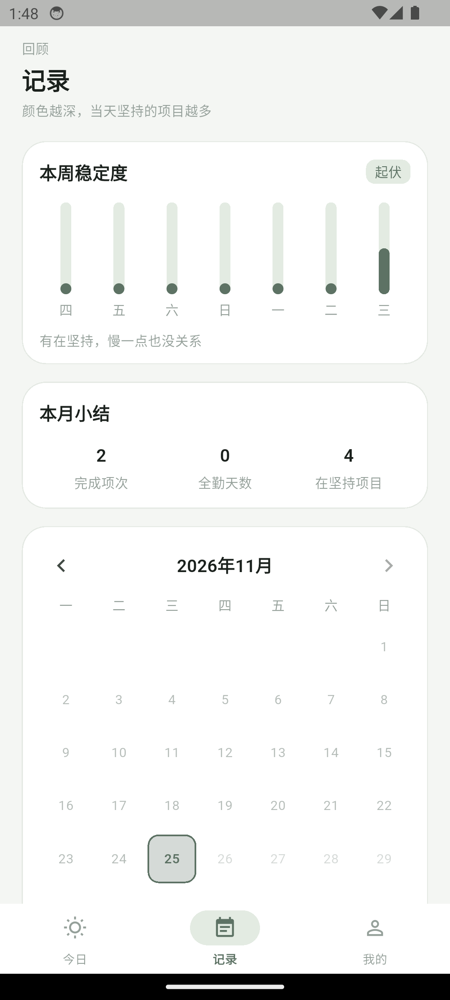

# LiveBetter

一个专注「长期坚持」的本地打卡 App。没有账号、没有云同步，所有记录只保存在你自己的手机里。

**Android 7.0+ ｜ 免费开源 ｜ 离线可用**

## 截图

| 今日 | 记录 | 我的 |
| --- | --- | --- |
|  |  |  |

## 能做什么

- **四种打卡方式**：主动完成、被动保持、累计计量、周期记录，想记什么都能找到合适的形式
- **不因一次中断而否定过去**：温和模式每周有一次豁免，断签不会让努力归零
- **看得见的积累**：当前连续、最长纪录、累计天数，月历色阶与每周稳定度一目了然
- **25 个健康预设**：早睡、喝水、运动、戒烟等一键添加，也能自定义名称与别名
- **quiet 的提醒与隐私**：本地通知、生物识别应用锁、敏感项名称隐藏、自定义卡片背景
- **数据归你**：JSON 导出 / 导入，换手机也能带走全部记录

设计原则：不评判、不催促。文案里没有「失败」「归零」「你搞砸了」。

## 下载安装

到 [Releases](https://github.com/bohemoon/LiveBetter/releases/latest) 下载最新的 `LiveBetter-v*-arm64.apk` 安装即可，首次安装需允许「安装未知应用」。

已安装旧版时，可在 App 内「我的 → 设置 → 检查更新」直接升级，数据不受影响。

## 隐私

- 不需要注册或登录，不收集任何个人数据
- 打卡记录、设置与背景图片只保存在本机
- 仅在检查更新时访问 GitHub 公开的 Release，不携带任何个人信息
- 无广告、无统计、无崩溃上报 SDK

详见 [隐私政策](PRIVACY.md)。

## 许可证

[Apache-2.0](LICENSE)
